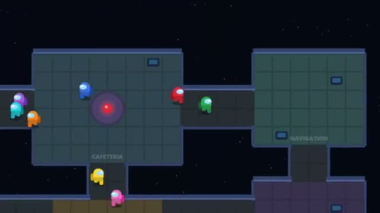

# Impostor Ship

Do your tasks. Find the impostor. A multiplayer starter game from [Multiplayer Agent](https://multiplayeragent.com): 2D, party, 4–10 players, with bots that fill empty seats.

## How it plays

The crew fixes the ship. One player is secretly the impostor. Report a body or hit the button, talk it out in chat and vote someone off. The crew wins when every task is done or the impostor is voted out; the impostor wins when it matches the crew.

**Controls:** WASD or drag to walk, E or USE for tasks, Q to kill, R to report.

## Make it yours in the Game Builder

Open the [Game Builder](https://multiplayeragent.com), choose **Start from a starter game** and pick Impostor Ship. It opens as version 1 in your studio, ready to play and publish. Then ask for changes, for example:

- Add a second impostor for 8 or more players
- Add a sheriff role
- Set it in a haunted mansion

## Run it yourself

1. Get a free publishable key (`pk_…`) at [multiplayeragent.com](https://multiplayeragent.com).
2. In `index.html`, put it in place of `pk_REPLACE_ME` in the `MP_CONNECT` block.
3. Open `index.html` in a browser. No build step and no server needed.

Without a key it still runs, offline against bots.

## How it is built

- One `index.html`. The comment at the top of the script maps the code and explains the multiplayer.
- **Hidden info:** Your role is sealed so only you can read it (the host deals, so it can too).
- **Host-run rules:** The host's browser deals roles, checks kills and counts votes; if it leaves, the next player takes over.
- **Bots:** Bots walk the ship, do tasks, report bodies, chat and vote. A bot impostor hunts too.
- **Leaderboard:** Games won, by each player.
- The ship is the `MAP` text block: one letter per tile, so you can redraw it in a text editor.
- `?attract` runs it offline with bots only. The preview video is recorded from it.

## License

MIT.
